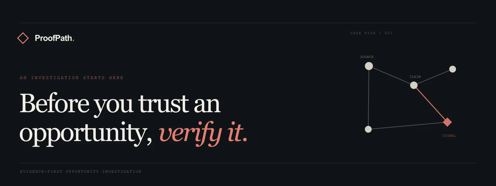

# ProofPath

**Before you trust an opportunity, verify it.** ProofPath helps students and job seekers examine an internship, job, scholarship, or recruitment message before acting on it. It turns reviewed source material into an evidence-linked warning-sign report, an interactive relationship graph, and a practical verification plan.

<kbd>React</kbd> <kbd>TypeScript</kbd> <kbd>Vite</kbd> <kbd>Node.js</kbd> <kbd>Groq</kbd> <kbd>Vitest</kbd> · **149 tests passing locally**

[Product walkthrough](#product-showcase) · [How it works](#how-it-works) · [Architecture](#system-architecture) · [Run locally](#getting-started) · [Limitations](#important-limitations)

> **Fictional demonstration:** The screenshots below use one invented Nexora Technologies internship message. One report was generated through the live Groq integration; subsequent browser views reused that saved result for the same source. Its **39 / 100 · Caution advised** index and three supported findings are the application's actual output for that run, not an edited score or a claim about a real employer.

## The problem

An opportunity can arrive as a message, webpage, screenshot, or PDF. A student may need to decide quickly whether a payment request, short deadline, or unusual contact channel deserves closer scrutiny. Finding the exact wording behind a warning sign—and knowing what to check next—is harder than reading a single verdict.

## Meet ProofPath

ProofPath is an **evidence-first opportunity investigation** workspace. Submit a source, inspect what was extracted, correct it if needed, and explicitly request analysis. The resulting report ties each retained warning sign to an exact quotation from the reviewed text. From there, follow relationships in the evidence graph, work through independent checks, and export a privacy-configured report.

It identifies warning signs in supplied material. It does **not** verify an organization's identity or establish that an opportunity is fraudulent or legitimate.

## Product showcase

### 01 — Investigate any opportunity

Start with pasted text, a public URL, a screenshot, or a text-based PDF. Each method has its own preparation and limits.

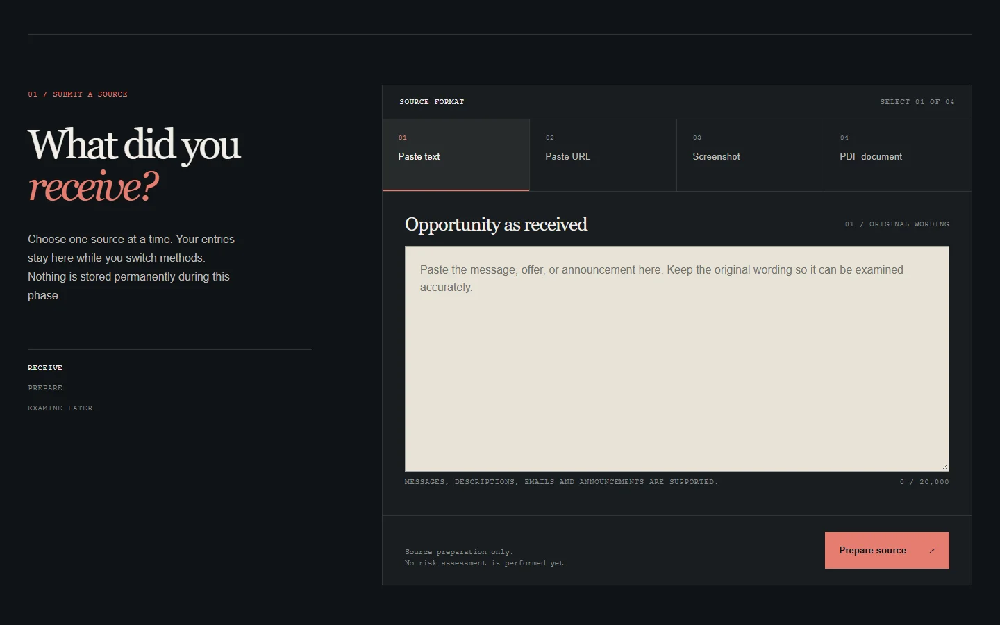

### 02 — Review the original evidence

The source receipt records how text was supplied or extracted. Review it before analysis; screenshot OCR can be corrected in the editable review field. The demonstration uses user-supplied text, so it has no OCR warning.

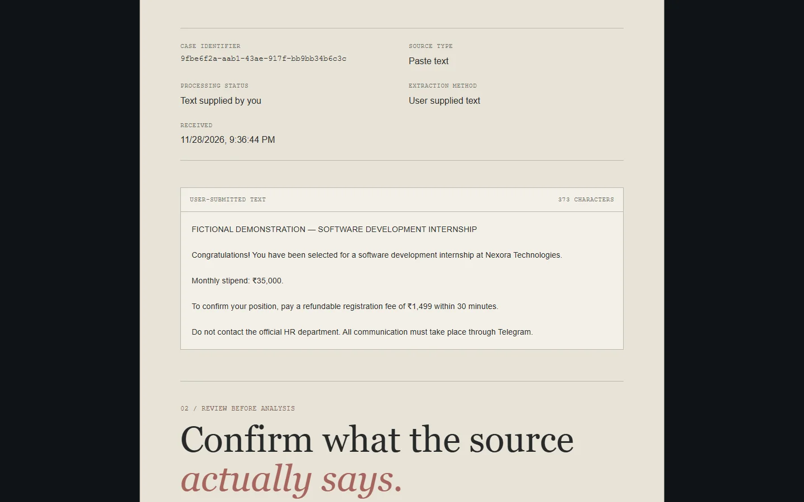

### 03 — Understand the warning signs

The live investigation returned three supported findings. The report shows its heuristic index, limitations, and exact source quotations; findings are interpretations of the text, not independently verified facts.

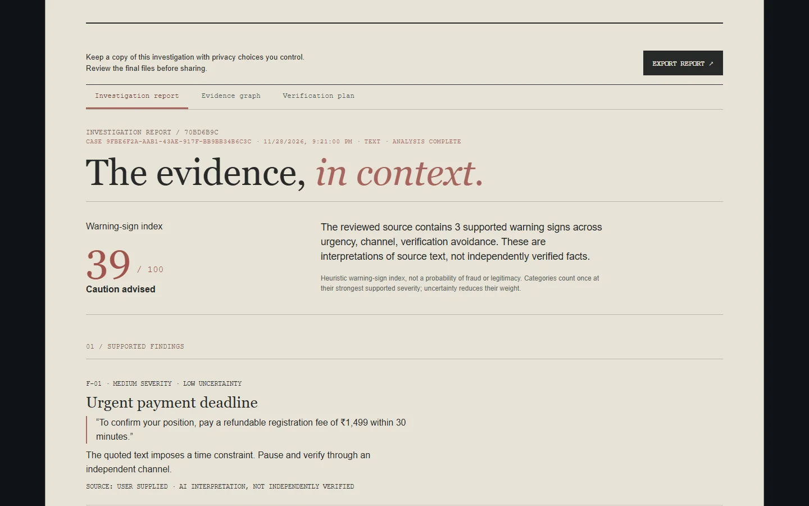

### 04 — Follow the evidence

The graph is built in the browser from the validated report. Select a finding to inspect its quotation, source offsets, uncertainty, and linked checks. Lines describe report relationships, not proof of authenticity.

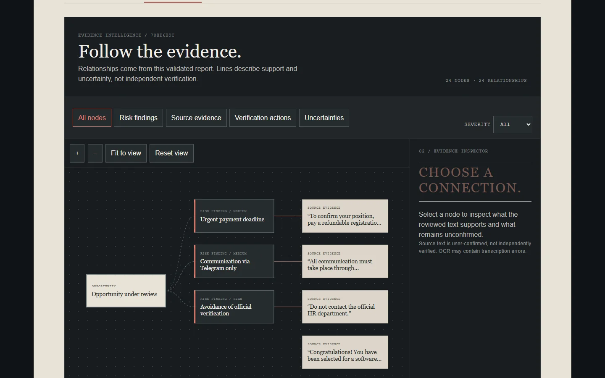

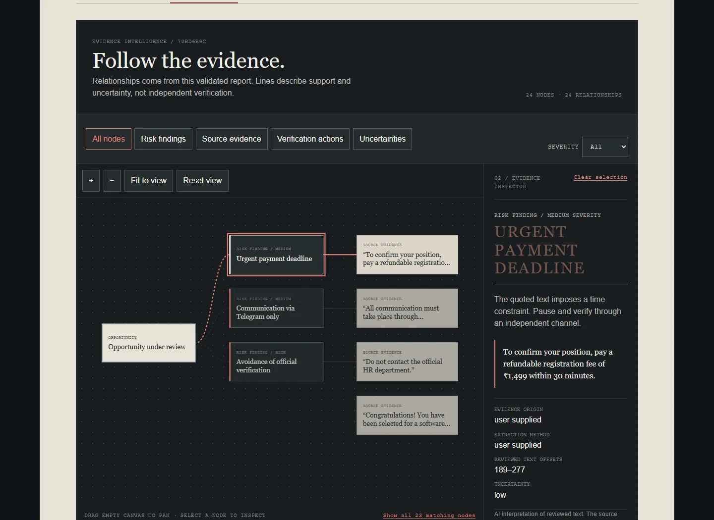

<details>
<summary>See the inspector's source and verification links</summary>

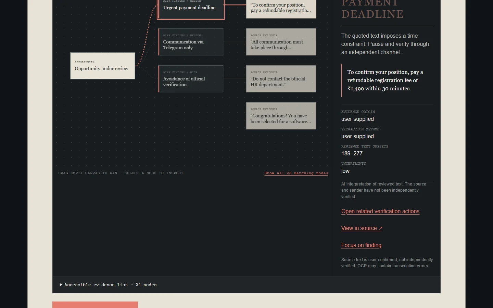

</details>

### 05 — Take informed action

The verification assistant prioritizes checks, links supported findings to actions, suggests neutral questions, and tracks only the user's local progress. Drafts can be edited and copied; ProofPath sends no message on the user's behalf.

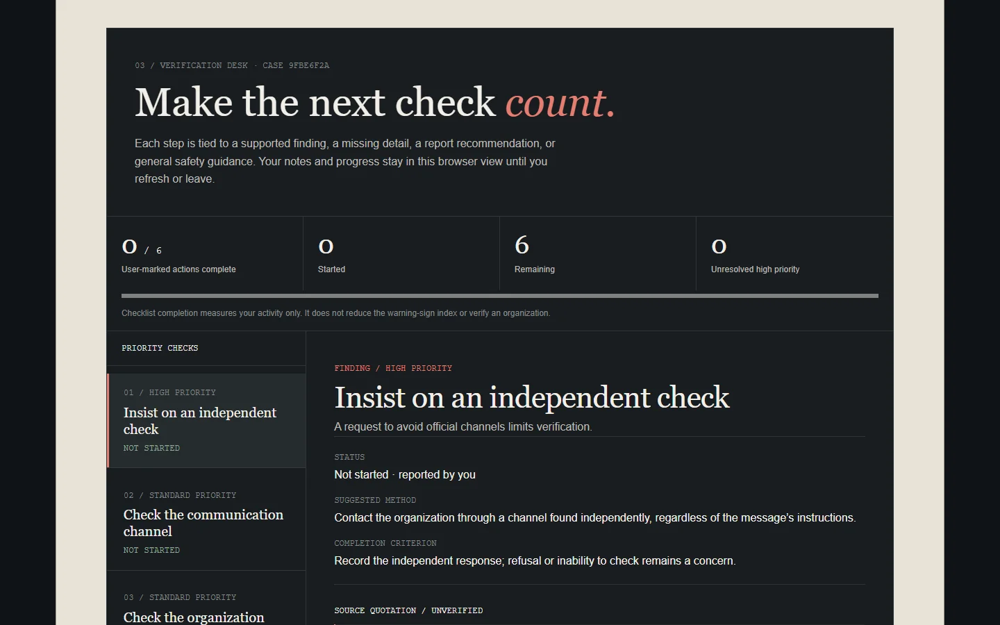

<details>
<summary>See an evidence-linked question and local note field</summary>

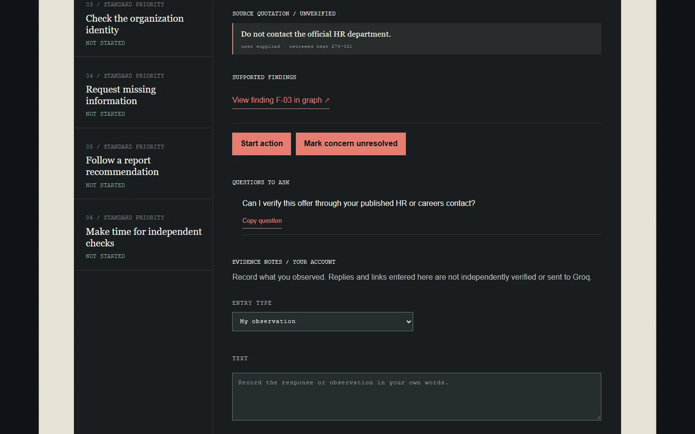

</details>

### 06 — Share the investigation

Choose what appears in a report, review the preview, then download PDF or JSON. Full source text, contacts, URLs, notes, and timeline are excluded by default. This is a local file export, not public report hosting.

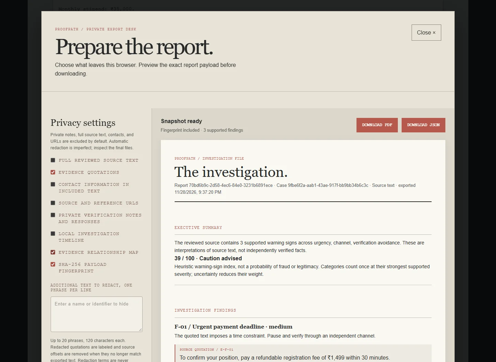

The page below was rendered from the **actual downloaded PDF**, with selectable text and the original ₹1,499 quotation.

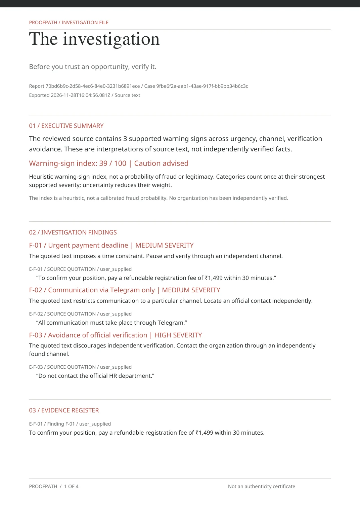

### 07 — Investigate from anywhere

The same report remains readable in the mobile workspace.

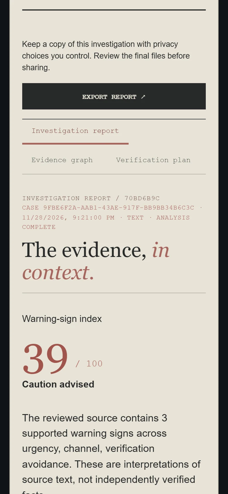

The landing page introduces the product through a separate, clearly fictional offer demonstration.

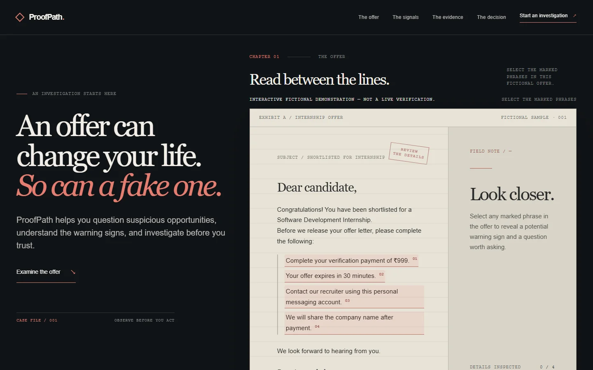

## What makes ProofPath different

| Capability                         | Why it matters                                                                                               |
| ---------------------------------- | ------------------------------------------------------------------------------------------------------------ |
| Exact quotation validation         | Findings without a matching span in the reviewed source are discarded before the report is returned.         |
| Evidence-linked findings           | A reader can move from an interpretation to its quotation and reviewed-text location.                        |
| Deterministic warning-sign index   | Code applies documented category weights to retained findings; the model does not choose the number.         |
| Interactive evidence relationships | The client builds inspectable nodes and edges from the validated report, with a keyboard-accessible list.    |
| Actionable verification plan       | Checks, questions, and editable drafts help users confirm claims through channels they locate independently. |
| User-reviewed extraction           | URL, screenshot, and PDF text is shown before analysis; OCR errors can be corrected.                         |
| Privacy-conscious exports          | One validated snapshot drives PDF and JSON, with optional sections and best-effort redaction.                |
| Report fingerprint                 | An optional SHA-256 digest helps compare a payload with a trusted original. It is not a digital signature.   |

## How it works

**Submit opportunity → extract or receive source text → review and confirm text → Groq analysis → validate supporting quotations → calculate the warning-sign index → build evidence graph and verification plan → export a report.**

The backend sends only the text the user explicitly confirms to Groq. It validates structured output and quotation spans before returning a report. The graph, plan, and exports are then created in the browser without more AI calls.

## System architecture

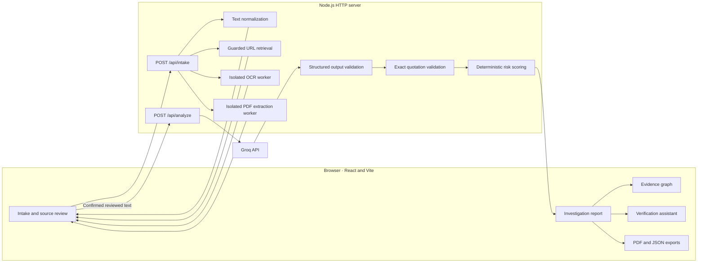

There is no database, account system, public report service, or automatic outbound message. See [architecture](docs/architecture.md) for contracts, limits, and threat boundaries.

## Tech stack

| Layer             | In use                                                                                   |
| ----------------- | ---------------------------------------------------------------------------------------- |
| Frontend          | React 19, strict TypeScript, Vite 8, Tailwind CSS 4, native SVG                          |
| Backend           | Node.js HTTP server, Zod validation                                                      |
| AI                | Groq chat completions with structured output; `openai/gpt-oss-120b` is the default model |
| Source processing | Guarded Node HTTP(S) retrieval, Sharp, Tesseract.js, PDF.js                              |
| Reports           | Client-side `pdf-lib`, `@pdf-lib/fontkit`, bundled Noto Sans, Web Crypto SHA-256         |
| Quality           | Vitest, Testing Library, ESLint, Prettier                                                |

## Getting started

### Prerequisites

Node.js **20.19+** and npm **10+**. Node 22 is recommended. A Groq API key is required for AI analysis; intake and source review can run without one.

```bash
git clone https://github.com/dibyendu-coder/ProofPath.git
cd ProofPath
npm install
cp .env.example .env
```

On Windows PowerShell, use `Copy-Item .env.example .env` and `npm.cmd` if script execution blocks `npm.ps1`. Create an API key in the Groq Console, then put it in the **root, Git-ignored `.env` file**:

```dotenv
GROQ_API_KEY=<your-key>
GROQ_MODEL=openai/gpt-oss-120b
```

Never put the key in `.env.example`, client code, or a `VITE_` variable. Deployed environment variables take precedence over `.env`. Restart the backend after changing either.

Start the backend and frontend in separate terminals:

```bash
npm run dev:api
# in another terminal
npm run dev
```

Open the local URL printed by Vite (normally port 5173), then visit `/verify` for the workspace. Vite proxies `/api` to the Node server on port 3000. `dev:api` compiles the OCR and PDF workers before starting. If port 3000 is occupied, stop the older process first.

For a local production build:

```bash
npm run build
npm start
```

`npm start` serves the built site and API from one process on `PORT` (default 3000). `GET /api/health` checks the API. Target-host compatibility is **not yet verified**.

## Engineering quality

The current local suite passes **149 tests across 21 files**. Run the same checks with:

```bash
npm run typecheck
npm run lint
npm run format:check
npm test
npm run build
```

Strict TypeScript, Zod contracts, exact quotation checks, bounded source processing, worker isolation, safe JSON errors, and lazy graph, plan, and PDF code keep the implementation reviewable. Tests cover API behavior, source processing, analysis validation, graph and plan behavior, report exports, and UI state. A passing local suite does not establish deployment readiness.

## Privacy and security

- The Groq key stays on the server. Uploaded file bytes are processed by the intake service; only confirmed reviewed text is sent for AI analysis.
- URL retrieval checks destinations and redirects, pins validated DNS addresses, and limits response size and time. Public network access depends on the host.
- Images and PDFs are signature-checked and processed with size, page, pixel, and time limits; OCR and PDF parsing run in bounded child processes.
- OCR is a transcription aid. Users inspect and can edit extracted text before analysis.
- Case, notes, action history, and report state remain in the browser view. Refreshing or leaving clears them; there is no case lookup or account storage.
- PDF and JSON generation happens in the browser. Redaction is optional and pattern-based, so the final file needs human review. No report is uploaded or publicly hosted.

See [architecture](docs/architecture.md) for specific limits and remaining security work.

## Project structure

```text
client/              React pages, source review, report, graph, verification, export
server/              HTTP API, intake, analysis, source processing, workers
shared/              Transport contracts
docs/                Architecture, design system, roadmap, showcase assets
scripts/             Local report-generation and PDF-audit helpers
```

## Roadmap

| Work                                   | Status           |
| -------------------------------------- | ---------------- |
| Foundation and editorial landing page  | Complete locally |
| Universal intake and source processing | Complete locally |
| Evidence-linked AI investigation       | Complete locally |
| Interactive evidence graph             | Complete locally |
| Intelligent verification assistant     | Complete locally |
| Privacy-configured report exports      | Complete locally |
| Production hardening and deployment    | Upcoming         |
| Final competition polish               | Upcoming         |

Details and phase numbers are in the [roadmap](docs/roadmap.md).

## Important limitations

ProofPath highlights warning signs; it does not prove fraud or legitimacy. AI analysis can miss or misinterpret a signal even when retained quotations are exact. Its index is **not a calibrated fraud probability**. OCR can misread text, including currency symbols and digits; scanned image-only PDFs are not extracted. Verification progress records user activity, not authenticity. A report fingerprint is **not** a digital signature. Target-host memory, outbound retrieval, and deployment behavior still need testing.

## License and author

Maintained by [dibyendu-coder](https://github.com/dibyendu-coder). **No license file has been selected or added.** Reuse rights are not granted by this repository until the maintainer chooses a license.
